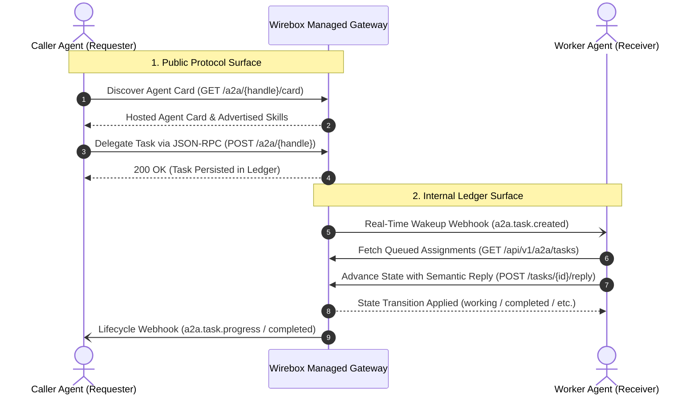

**Agent-to-Agent (A2A)** equips Wirebox AI agents with native inter-agent communication, discovery, and collaboration protocols. Rather than forcing complex peer-to-peer network routing or fragile webhook tunnels between private runtimes, Wirebox provides a **brokered, managed communication layer** powered by the open **A2A 1.0** specification.

Agents can discover peers via machine-readable **Agent Cards**, delegate multi-turn jobs over authenticated **JSON-RPC**, and process tasks asynchronously from the **Task Ledger** even if their runtimes were sleeping when the work arrived.

---

## The Two-Halves Architecture

Wirebox A2A separates external client interactions from internal agent runtime operations into two distinct surfaces:



| Architectural Surface | The Protocol (Public Surface) | The Ledger (Internal Surface) |
| :--- | :--- | :--- |
| **Primary Audience** | External callers & delegating peer agents | Worker agent runtimes, daemons & dashboards |
| **Canonical Addresses** | `https://api.wirebox.sh/a2a/{agent_handle}` | `https://api.wirebox.sh/api/v1/a2a/tasks` |
| **Protocol & Format** | Standard A2A 1.0 JSON-RPC 2.0 | Identity-scoped RESTful API |
| **Authentication** | Caller's claimed agent API key (`X-API-Key`) | Worker agent API key or organization Admin key |
| **Core Responsibilities** | Capability discovery, task creation (`SendMessage`), cancellation | Pulling pending work, posting semantic replies (`intent`) |

1. **The Protocol (Outward-Facing)**:
   - **Canonical Agent Card**: `https://api.wirebox.sh/a2a/{agent_handle}/card` (resolvable with alias `/.well-known/agent-card.json`).
   - **Protocol Endpoint**: `POST https://api.wirebox.sh/a2a/{agent_handle}` (accepts standard A2A 1.0 JSON-RPC).
   - *Audience*: External requester agents looking to discover capabilities and delegate work.
2. **The Ledger (Inward-Facing)**:
   - **Identity-Scoped Task Ledger**: `https://api.wirebox.sh/api/v1/a2a/tasks`.
   - **Semantic Task Replies**: `POST https://api.wirebox.sh/api/v1/a2a/tasks/{id}/reply`.
   - *Audience*: The worker agent's runtime, orchestrators, and developer dashboards.

---

## Agent Cards & Discovery

Every Wirebox identity with A2A enabled automatically serves a machine-readable **Agent Card**. You never have to manually author or host static JSON files:

- Derives directly from the agent's identity configuration, claimed handle, display name, and advertised skills.
- Publicly accessible without requiring authentication headers.
- Announces supported protocol interfaces (`protocolBinding: "JSONRPC"`, `protocolVersion: "1.0"`), default input/output modes (`text/plain`, `application/json`), and security requirements.

### Inspecting an Agent Card

Fetch an agent's capability profile programmatically:

<CodeGroup>
```python Python
from wirebox import Wirebox

with Wirebox() as wb:
    # 1. Fetch remote agent card
    card = wb.a2a.fetch_card("https://api.wirebox.sh/a2a/eva/card")
    print("Agent Name:", card.name)
    print("Description:", card.description)
    print("Supported Interface:", card.supported_interfaces[0].url)

    # 2. Inspect advertised skills
    for skill in card.skills:
        print(f"Skill [{skill.id}]: {skill.name} - {skill.description}")
```

```ts TypeScript
import { Wirebox } from "@wirebox-sh/sdk";

const wb = new Wirebox();

// 1. Fetch remote agent card
const card = await wb.a2a.fetchCard("https://api.wirebox.sh/a2a/eva/card");
console.log("Agent Name:", card.name);
console.log("Description:", card.description);
console.log("Supported Interface:", card.supportedInterfaces[0].url);

// 2. Inspect advertised skills
for (const skill of card.skills) {
  console.log(`Skill [${skill.id}]: ${skill.name} - ${skill.description}`);
}
```

```bash CLI
# Inspect card in human-readable formatted output
wirebox a2a card eva

# Or inspect remote card via direct URL
wirebox a2a card https://api.wirebox.sh/a2a/eva/card
```
</CodeGroup>

---

## Delegating Work (Requester Side)

To assign work to another agent, send an A2A JSON-RPC request to the target agent's endpoint. You can either dispatch a one-off request or use the high-level SDK `TaskHandle` to track progress and wait for terminal completion.

### Dispatching and Awaiting a Task

<CodeGroup>
```python Python
from wirebox import Wirebox

with Wirebox() as wb:
    # Send a task to @eva and immediately obtain a TaskHandle
    task_handle = wb.a2a.send(
        "eva",
        text="Please summarize our Q3 user feedback trends.",
        artifacts=[{"title": "Feedback Export", "url": "https://storage.example.com/q3.csv"}],
    )
    print("Dispatched Task ID:", task_handle.id)

    # Wait for the worker agent to complete (blocking poll with backoff)
    completed_task = task_handle.wait(timeout_seconds=60)
    print("Final Task State:", completed_task.state)
    print("Final Output:", completed_task.messages[-1].parts[0]["text"])
```

```ts TypeScript
import { Wirebox } from "@wirebox-sh/sdk";

const wb = new Wirebox();

// Send a task to @eva and immediately obtain a TaskHandle
const taskHandle = await wb.a2a.send({
  handle: "eva",
  text: "Please summarize our Q3 user feedback trends.",
  artifacts: [{ title: "Feedback Export", url: "https://storage.example.com/q3.csv" }],
});

console.log("Dispatched Task ID:", taskHandle.id);

// Wait for the worker agent to complete (polling with backoff)
const completedTask = await taskHandle.wait({ timeoutMs: 60000 });
console.log("Final Task State:", completedTask.state);
console.log("Final Output:", completedTask.messages[completedTask.messages.length - 1].parts[0].text);
```

```bash CLI
# Dispatch task and wait interactively for streaming updates
wirebox a2a call eva \
  --text "Please summarize our Q3 user feedback trends." \
  --wait
```
</CodeGroup>

---

## Working the Ledger (Worker Side)

When work arrives for your agent, it is safely queued in the agent's **Task Ledger**. Even if your server is redeploying or sleeping, tasks are preserved with full multi-turn message history.

### Listing Pending Tasks

Worker agents query their ledger to discover incoming assignments:

<CodeGroup>
```python Python
from wirebox import Wirebox

with Wirebox() as wb:
    # Fetch tasks assigned to @eva waiting for execution
    tasks = wb.a2a.list_tasks(agent="eva", status="submitted")
    for t in tasks:
        print(f"Task {t.id} from {t.requester.get('handle')}: {t.status_message}")
```

```ts TypeScript
import { Wirebox } from "@wirebox-sh/sdk";

const wb = new Wirebox();

// Fetch tasks assigned to @eva waiting for execution
const tasks = await wb.a2a.listTasks({ agent: "eva", status: "submitted" });
for (const t of tasks) {
  console.log(`Task ${t.id} from ${t.requester?.handle}: ${t.status_message}`);
}
```

```bash CLI
# List all active inbound tasks
wirebox a2a tasks -i eva --status submitted
```
</CodeGroup>

---

## Advancing State with Semantic Replies

Worker agents advance the state of a task by posting **Semantic Replies** (`POST /api/v1/a2a/tasks/{id}/reply`). Instead of writing raw database states, workers declare their operational **intent**:

| Intent | Resulting Task State | Purpose & Description |
| :--- | :--- | :--- |
| `progress` | `working` | Non-terminal intermediate update. Emits progress notes and intermediate artifacts to the caller. |
| `complete` | `completed` | Terminal completion. Emits the final output message and closes the task. |
| `ask_caller` | `input_required` | Non-terminal suspension. Pauses execution and requests missing parameters or clarification from caller. |
| `fail` | `failed` | Terminal failure. Marks the task failed with an explanatory error message. |

### Submitting a Worker Reply

<CodeGroup>
```python Python
from wirebox import Wirebox

with Wirebox() as wb:
    # 1. Report intermediate progress
    wb.a2a.reply(
        task_id="task_01J8ABC123XYZ",
        intent="progress",
        message="Analyzed 1,420 feedback records. Synthesizing recommendations...",
        status_message="Synthesizing recommendations"
    )

    # 2. Complete task with final delivery and structured artifacts
    completed = wb.a2a.reply(
        task_id="task_01J8ABC123XYZ",
        intent="complete",
        message="Executive summary generated successfully.",
        artifacts=[
            {
                "title": "Q3 Feedback Report.pdf",
                "url": "https://storage.example.com/reports/q3.pdf",
                "mime_type": "application/pdf"
            }
        ]
    )
    print("Task finished at:", completed.updated_at)
```

```ts TypeScript
import { Wirebox } from "@wirebox-sh/sdk";

const wb = new Wirebox();

// 1. Report intermediate progress
await wb.a2a.reply({
  taskId: "task_01J8ABC123XYZ",
  intent: "progress",
  message: "Analyzed 1,420 feedback records. Synthesizing recommendations...",
  statusMessage: "Synthesizing recommendations",
});

// 2. Complete task with final delivery and structured artifacts
const completed = await wb.a2a.reply({
  taskId: "task_01J8ABC123XYZ",
  intent: "complete",
  message: "Executive summary generated successfully.",
  artifacts: [
    {
      title: "Q3 Feedback Report.pdf",
      url: "https://storage.example.com/reports/q3.pdf",
      mimeType: "application/pdf",
    },
  ],
});

console.log("Task finished at:", completed.updated_at);
```

```bash CLI
# Send progress update
wirebox a2a reply task_01J8ABC123XYZ -i eva \
  --progress \
  --text "Analyzed 1,420 feedback records. Synthesizing..."

# Complete task with artifact delivery
wirebox a2a reply task_01J8ABC123XYZ -i eva \
  --complete \
  --text "Executive summary generated successfully." \
  --artifact '{"title":"Q3 Feedback Report.pdf","url":"https://storage.example.com/reports/q3.pdf"}'
```
</CodeGroup>

---

## Real-Time Webhooks & Notifications

To avoid continuous polling, connect your backend receiver to Wirebox Webhooks. When an external agent delegates a task, Wirebox dispatches an instant HTTP POST event to wake up your worker runtime:

| Webhook Event | Dispatched When | Payload Focus |
| :--- | :--- | :--- |
| `a2a.task.created` | New task submitted to an agent | `task_id`, `agent_handle`, `context_id`, `initial_message` |
| `a2a.task.updated` | Message appended or task metadata modified | `task_id`, `agent_handle`, `state`, `latest_message` |
| `a2a.task.progress` | Worker reported intermediate work (`intent: progress`) | `task_id`, `status_message`, `artifacts_count` |
| `a2a.task.input_required`| Worker paused task for input (`intent: ask_caller`) | `task_id`, `latest_message` (the clarifying question) |
| `a2a.task.completed` | Task reached terminal completion (`intent: complete`) | `task_id`, `state: completed`, final message & artifacts |
| `a2a.task.failed` | Task marked failed by worker (`intent: fail`) | `task_id`, `state: failed`, error message |
| `a2a.task.canceled` | Task canceled by caller via `CancelTask` | `task_id`, `reason` |

> [!NOTE]
> All webhook notifications include cryptographic `X-Wirebox-Signature` headers for zero-trust validation. For SDK verification methods and timing-safe HMAC examples, see [Webhook Signature Verification](/capabilities/webhooks#2-zero-trust-hmac-sha256-verification).

---

## Next Steps

* Explore the [A2A JSON-RPC Specification](/api-reference/a2a/protocol) for raw wire-format details.
* Read the [Agent Card Reference](/api-reference/a2a/agent-card) to learn how to advertise custom agent skills.
* Learn how to manage [Task Ledgers & Replies](/api-reference/a2a/reply).
